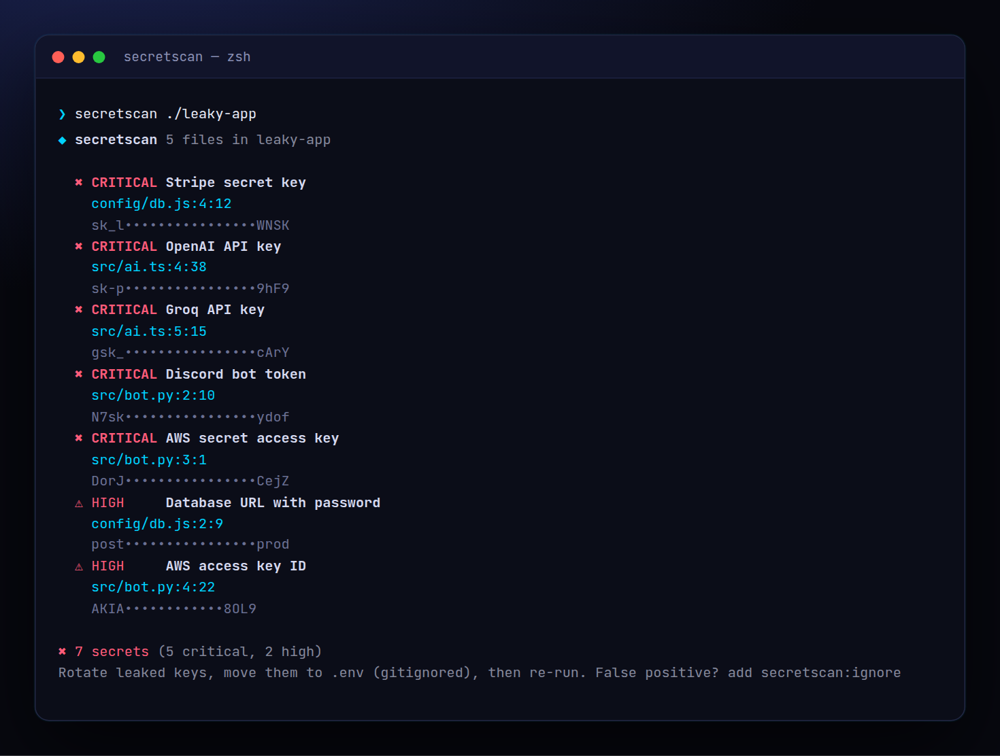

<!-- ═════════════ HEADER ═════════════ -->
<p align="center">
  
</p>

<p align="center">
  
</p>

<p align="center">
  <a href="https://github.com/krishyaa06/prism-secret-scan/actions/workflows/ci.yml"></a>
  
  
  <a href="LICENSE"></a>
</p>

<p align="center">
  
</p>


## ⚡ Overview

**Prism Secret Scan** (`secretscan`) looks for API keys, tokens, private keys and passwords that ended up in your code. Vibe coding makes this easy to do by accident — the AI pastes your key "just for testing" and it gets pushed. It knows the exact formats of 28 providers (including AI APIs like OpenAI, Anthropic, Groq, Gemini, Hugging Face, Replicate), uses entropy to catch generic hardcoded secrets while ignoring placeholders like `your-key-here` and `process.env.X`, and `--history` scans **every commit** — because deleting a key from the code does not delete it from git.

## ✨ Features

- **28 detectors**: OpenAI, Anthropic, Groq, Gemini, Hugging Face, Replicate, GitHub, GitLab, npm, AWS, Stripe, Slack, Discord, Telegram, Twilio, SendGrid, Supabase, JWTs, private keys, DB URLs…
- **Entropy + placeholder filtering**: ignores `your-key-here`, `xxxx`, `process.env`, `${VAR}`, localhost examples
- `--history` scans **all commits on all branches** and shows commit, author and date
- Output is **masked** by default (`sk-p••••fygw`); `--show` to reveal
- `--baseline` to accept known findings; `.secretscanignore` + `secretscan:ignore` comments
- `--sarif` for GitHub code scanning, `--json`, `--severity`. Exit 1 on findings. Zero deps

## 🚀 Quick Start

```bash
# run without installing
npx github:krishyaa06/prism-secret-scan 

# or install globally
npm install -g github:krishyaa06/prism-secret-scan
secretscan --history
```

Requires Node.js 18.17+. No dependencies.

## 🛠️ Usage

```text
secretscan [dir]              scan files in the working tree
secretscan --history          scan every commit
secretscan --list             show all detectors

    --baseline          accept current findings (.secretscan-baseline.json)
    --severity <lvl>    minimum: low | medium | high | critical
    --show              print secrets unmasked (careful)
    --json | --sarif    machine output
-e, --exclude <glob>    extra ignore patterns (or .secretscanignore)
```

### Found a key? Do this

1. **Rotate it** in the provider's dashboard — assume it is compromised.
2. Move it to `.env` and make sure `.env` is in `.gitignore`.
3. If it was ever pushed, rewriting history (`git filter-repo`) is optional; rotating is not.

### GitHub code scanning

```yaml
- run: npx --yes github:krishyaa06/prism-secret-scan --sarif > secrets.sarif || true
- uses: github/codeql-action/upload-sarif@v3
  with: { sarif_file: secrets.sarif }
```

### Try it

```bash
node examples/make-leaky-app.js /tmp/leaky-app   # fake project with random, fake keys
secretscan /tmp/leaky-app
```

## 📁 Project Structure

```text
prism-secret-scan/
├── assets/
│   ├── logo.png
│   └── logo.svg
├── bin/
│   └── secretscan.js
├── examples/
│   └── make-leaky-app.js   # generates a demo with fake keys
├── src/
│   ├── index.js   # scanner, history, baseline, SARIF
│   ├── rules.js   # 28 detectors
│   ├── ui.js
│   └── walk.js
├── test/
│   └── secretscan.test.js
├── .gitignore
├── .secretscanignore
├── LICENSE
├── README.md
└── package.json
```

## 🧪 Tests

```bash
npm test
```

Tests use the built-in `node:test` runner, so there is nothing to install. CI runs them on Node 20 and 22.

## 🤝 Contributing

1. Fork the repo and create a branch: `git checkout -b feature/my-idea`
2. Make your change and add a test in `test/`
3. Run `npm test` and open a Pull Request

## 🔷 Part of Prism Protocol

Prism Secret Scan is one of the open-source tools built by [Prism Protocol](https://dc.gg/prismprotocol), a tech community where young builders learn, ship and compete together.

## 👤 Author

<table>
  <tr>
    <td align="center">
      <a href="https://github.com/krishyaa06"><br><b>Soumya Bhandare</b></a><br>
      <sub>Founder @ Prism Protocol</sub>
    </td>
    <td>
      <a href="https://dc.gg/prismprotocol"></a><br>
      <a href="https://instagram.com/prism_protocol_"></a><br>
      <a href="https://x.com/krishyaa06"></a>
    </td>
  </tr>
</table>

## 📄 License

Released under the [MIT License](LICENSE).

<p align="center">
  <b>If you like this project, consider giving it a ⭐</b><br>
  <sub>"Build. Create. Compete." · Made with ⚡ by Prism Protocol</sub>
</p>


